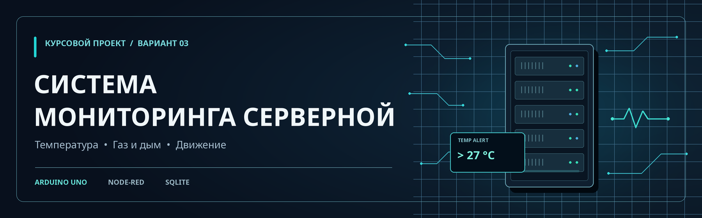
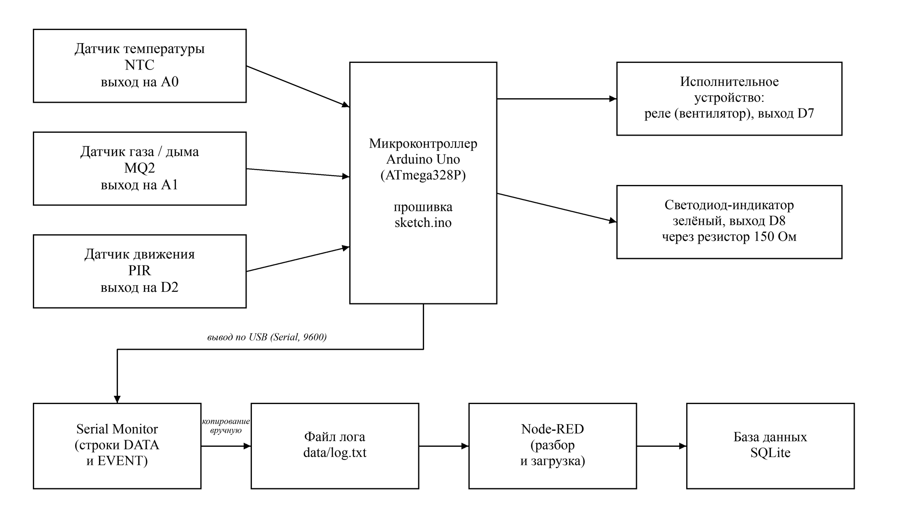
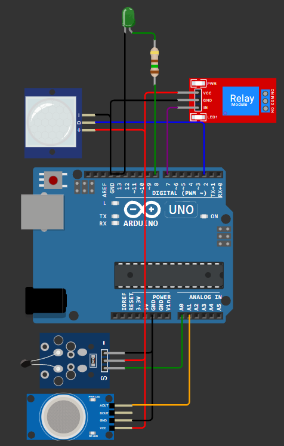
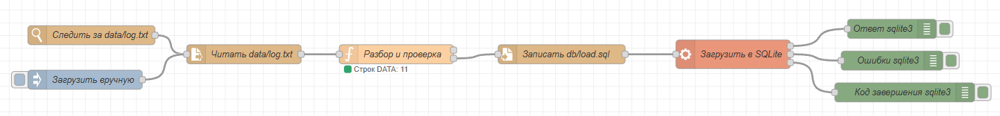
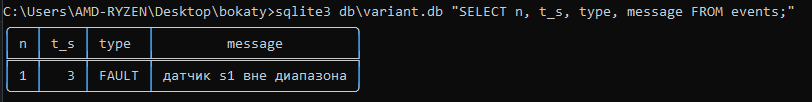

# 🖥️ Система мониторинга серверной

Курсовой проект по разработке виртуальной системы сбора и учёта данных на **Arduino Uno**.

**Вариант № 3 · Бокатый Григорий Владимирович · группа 54-15**

---

## 📋 О проекте

Система контролирует температуру, уровень газа или дыма и движение в серверной. При повышении температуры выше **27 °C** Arduino подаёт сигнал на реле вентилятора и включает световой индикатор.

Показания сохраняются в журнал, обрабатываются в **Node-RED** и загружаются в базу **SQLite**.

## 🔧 Компоненты

| Компонент | Назначение | Подключение |
|---|---|---|
| Arduino Uno | Управление системой | — |
| NTC | Измерение температуры | A0 |
| MQ2 | Контроль газа и дыма | A1 |
| PIR | Обнаружение движения | D2 |
| Реле | Управление вентилятором | D7 |
| Зелёный светодиод | Световая индикация | D8 |

**Период опроса:** 3 секунды  
**Порог температуры:** 27 °C  
**Скорость Serial:** 9600 бод

## 🗂️ Структурная схема



## ⚙️ Модель в Wokwi



## 🔄 Обработка данных

Вывод Serial Monitor сохраняется в `data/log.txt`. Поток Node-RED разбирает журнал и загружает показания и события в SQLite.



### Запуск

1. Запустить `start-nodered.bat`.
2. Открыть `http://localhost:1880`.
3. Импортировать `nodered/flow.json` и нажать **Deploy**.
4. Запустить симуляцию в Wokwi и сохранить вывод Serial Monitor в `data/log.txt`.
5. Проверить данные из папки проекта:

```bat
sqlite3 -header -column db\variant.db ".read db\queries.sql"
```

## 🧪 Проверка неисправности

При выходе показания за допустимый диапазон в базе создаётся событие **FAULT**. Тестовый журнал находится в `data/log_fault.txt`.



## 📁 Файлы проекта

| Папка | Содержимое |
|---|---|
| `firmware/` | Прошивка Arduino |
| `sim/` | Модель Wokwi |
| `nodered/` | Поток Node-RED |
| `db/` | Схема базы данных и запросы |
| `data/` | Журналы измерений |
| `docs/` | Схемы и скриншоты |